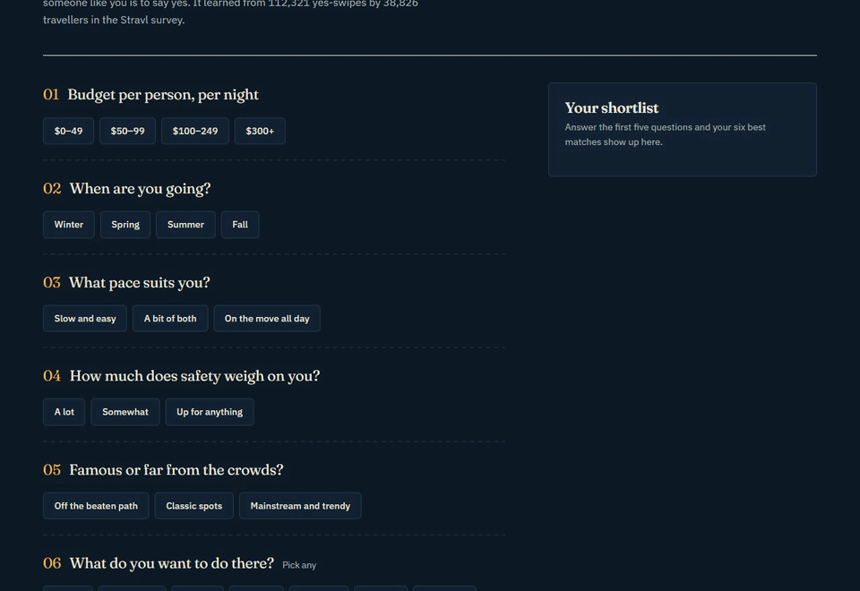
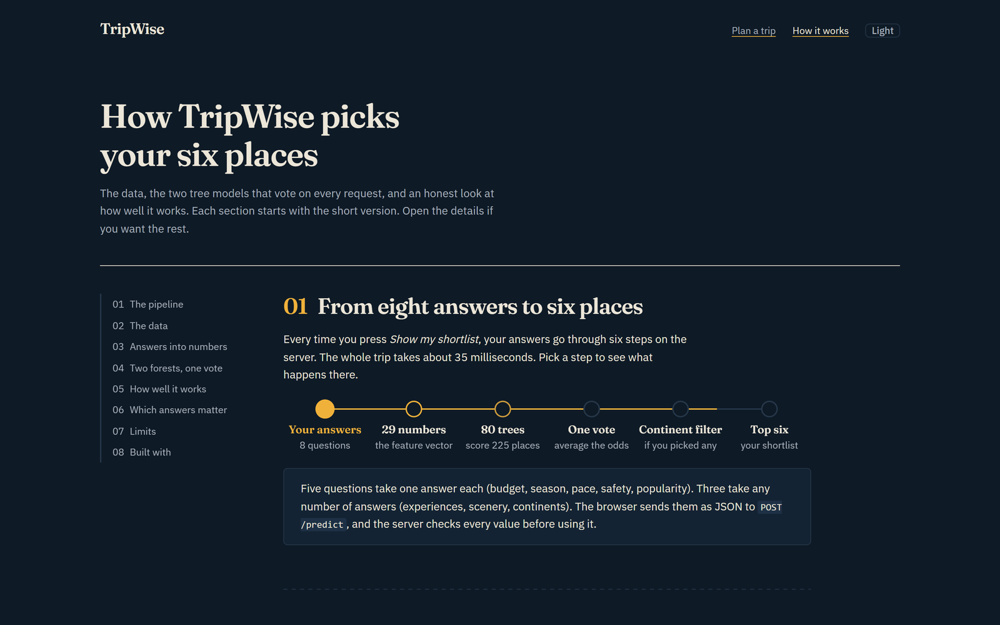
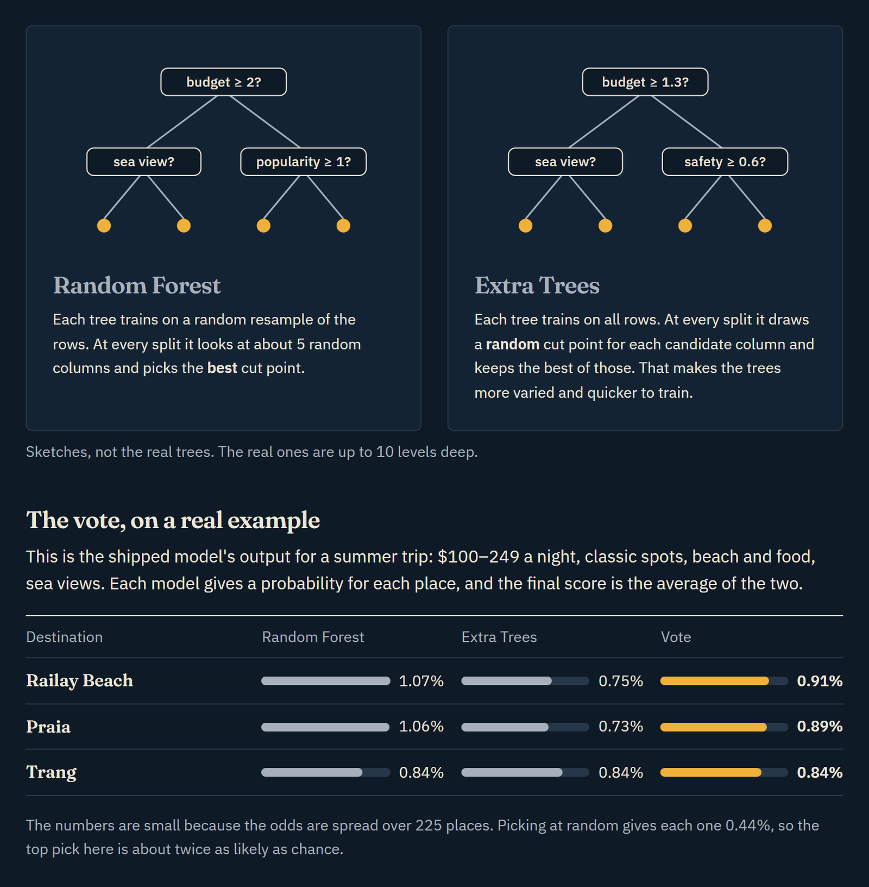
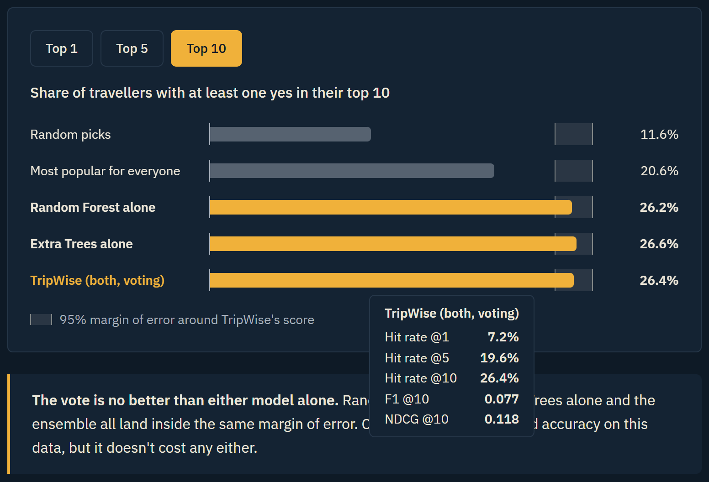
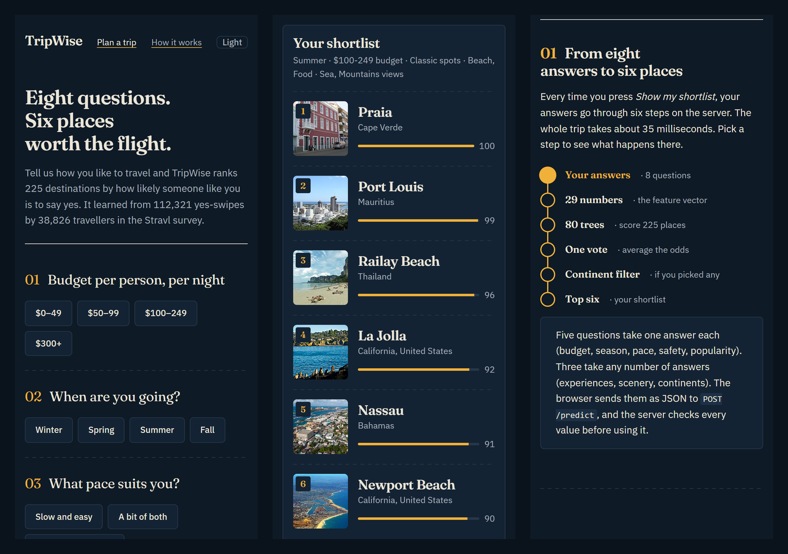

# TripWise

**Eight questions. Six places worth the flight.**

TripWise recommends travel destinations. You answer eight quick questions about budget, season, pace and what you enjoy, and a machine-learning model ranks 225 destinations by how likely someone like you is to say yes. It learned from 112,321 yes-swipes by 38,826 real travellers in the [Stravl Travel Preference Dataset](https://github.com/Stravl/Stravl-Data).



| | |
| --- | --- |
| **Model** | Random Forest + Extra Trees, soft-voting ensemble (scikit-learn) |
| **Result** | 26.4% hit rate @10, vs 20.7% for "most popular" and 11.6% for random picks |
| **Speed** | About 35 ms per prediction |
| **Stack** | Python, Flask, scikit-learn, NumPy, plain HTML/CSS/JS, Vercel |

## Features

- **Questionnaire and shortlist:** eight questions give six matches, each with a Wikipedia photo and a fit score.
- **How it works page:** an interactive walkthrough of the data, the features, both algorithms and the evaluation, with charts, a live feature encoder and animated diagrams.
- **Dark and light themes:** works on phones, has full keyboard support, meets WCAG AA contrast, and respects reduced-motion settings.
- **Validated API:** malformed input gets a clear `400` error instead of a crash.



## How it works

```
Your answers ─► 29 numbers ─► 80 trees ─► one vote ─► continent filter ─► top 6
```

1. **Data.** Each yes-swipe in the Stravl survey becomes one training row: the traveller's answers are the inputs and the destination is the label. The model keeps the 225 most-swiped places with at least 15 swipes each, balanced across six continents.
2. **Features.** Five single-choice answers stay as numbers (budget, season, pace, safety, popularity). Three multi-choice answers become 0/1 columns (experiences, scenery, regions). That's 29 columns in total.
3. **Models.** A Random Forest (each tree trains on a random resample and picks the best cut points) and Extra Trees (each tree trains on all rows and picks random cut points). Both use 40 trees, a maximum depth of 10 and balanced class weights.
4. **Vote.** The two models' probabilities are averaged, the destinations outside the continents you picked are removed, and the top six are returned.



## Evaluation

`evaluate.py` holds out **10% of travellers** (3,883 people the model never sees). It splits by person rather than by row, so no traveller appears in both training and test. Each held-out traveller gets a ranking of all 225 places, which is compared with the places they actually liked.

| Metric | TripWise | Most popular | Random |
| --- | --- | --- | --- |
| Hit rate @10 | **26.4%** | 20.7% | 11.6% |
| Hit rate @1 | **7.2%** | 4.7% | 1.2% |
| F1 @10 | **0.077** | 0.047 | 0.018 |
| NDCG @10 | **0.119** | 0.072 | 0.027 |
| Accuracy (top 1, 225 classes) | **2.5%** | 1.6% | 0.4% |
| Log loss (lower is better) | **5.04** | – | 5.42 |



<details>
<summary><b>All metrics, and what they mean</b></summary>

**Per traveller (ranking)**

| Metric | TripWise | RF alone | ET alone | Most popular | Random |
| --- | --- | --- | --- | --- | --- |
| Hit rate @1 / @5 / @10 | 0.072 / 0.196 / 0.264 | 0.074 / 0.194 / 0.262 | 0.075 / 0.197 / 0.266 | 0.047 / 0.140 / 0.207 | 0.012 / 0.054 / 0.116 |
| Precision @5 / @10 | 0.064 / 0.054 | 0.064 / 0.053 | 0.064 / 0.053 | 0.036 / 0.033 | 0.012 / 0.013 |
| Recall @5 / @10 | 0.104 / 0.171 | 0.104 / 0.169 | 0.103 / 0.169 | 0.060 / 0.106 | 0.021 / 0.045 |
| F1 @5 / @10 | 0.073 / 0.077 | 0.073 / 0.076 | 0.073 / 0.076 | 0.041 / 0.047 | 0.013 / 0.018 |
| MRR | 0.144 | 0.144 | 0.146 | 0.110 | 0.053 |
| NDCG @10 | 0.119 | 0.118 | 0.119 | 0.072 | 0.027 |

**Per liked place (225-class classification)**

| Metric | TripWise | RF alone | ET alone |
| --- | --- | --- | --- |
| Accuracy / top-5 / top-10 | 0.025 / 0.112 / 0.187 | 0.026 / 0.111 / 0.186 | 0.026 / 0.111 / 0.186 |
| Balanced accuracy | 0.025 | 0.026 | 0.026 |
| Precision / recall / F1 (macro) | 0.018 / 0.025 / 0.017 | 0.025 / 0.026 / 0.018 | 0.017 / 0.026 / 0.016 |
| Precision / recall / F1 (weighted) | 0.023 / 0.025 / 0.019 | 0.033 / 0.026 / 0.021 | 0.021 / 0.026 / 0.019 |
| Log loss | 5.044 | 5.074 | 5.086 |

**Definitions**

- **Hit rate @k:** share of travellers with at least one liked place in their top k.
- **Precision / recall @k:** share of the k suggestions that were liked, and share of liked places that made the top k.
- **MRR:** 1 ÷ the position of the first liked place, averaged over travellers.
- **NDCG @10:** rewards liked places near the top of the list.
- **Macro vs weighted:** macro averages every destination equally; weighted averages by how often each destination appears.
- **Log loss:** a uniform guess over 225 classes scores 5.42.

Full results are in [`metrics.json`](metrics.json).

</details>

**What the numbers say**

- **They're low in absolute terms because the problem is hard.** There are 225 possible answers and only eight survey questions. What matters is the lift: TripWise's hit rate @10 is 28% higher than recommending the most popular places.
- **The ensemble ties each model alone.** On hit rate @10, Random Forest alone scores 26.2% and Extra Trees alone 26.6%, both within the ±1.4-point margin of error.
- **Only four questions measurably matter:** continent, popularity, budget and scenery. Shuffling pace, safety, season or experiences doesn't change the results.

## Run locally

```bash
git clone https://github.com/HP0077/TripWise.git
cd TripWise
pip install -r requirements.txt
python app.py              # then open http://localhost:5000
```

- **Tests:** `pip install -r requirements-dev.txt`, then `python -m pytest` (22 tests).
- **Retraining:** download the CSV from [Stravl-Data](https://github.com/Stravl/Stravl-Data) into the project folder, then run `python train_model.py` and `python evaluate.py`.
- **scikit-learn:** pinned to `1.8.0`, the version `model.pkl` was saved with.



## Deploy to Vercel

The repo is ready for Vercel. Import it at [vercel.com](https://vercel.com) under **Add New → Project** and click **Deploy**, with no settings or keys needed. `vercel.json` keeps the app bundle small (about 300 MB of the 500 MB limit), and `public/static/` is served from Vercel's CDN. Render also works using `Procfile` and `render.yaml`.

## Project structure

```
app.py                 Flask app: validation, features, prediction, routes
train_model.py         Training
evaluate.py            Evaluation, baselines and metrics → metrics.json
model.pkl, *.pkl       Trained model and encoders
templates/             Pages (home, how it works, 404)
public/static/         CSS, JavaScript, favicon
tests/                 API and page tests
```

## License

The code is released under the [MIT License](LICENSE). The survey data comes from [Stravl](https://github.com/Stravl/Stravl-Data), which makes it free for academic and commercial use. Photos load live from Wikipedia under their own licenses, and the fonts (Fraunces and IBM Plex Sans) are under the SIL Open Font License.

Built by Huzaifa Pathan.
